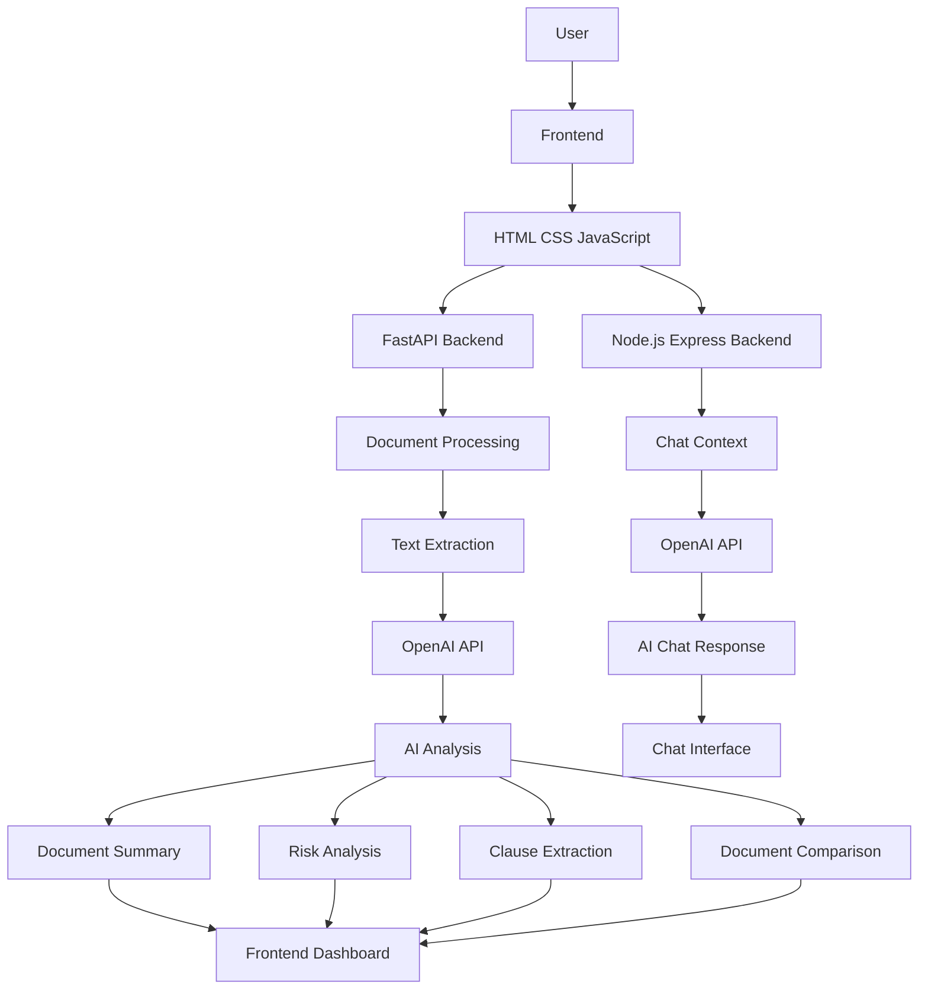
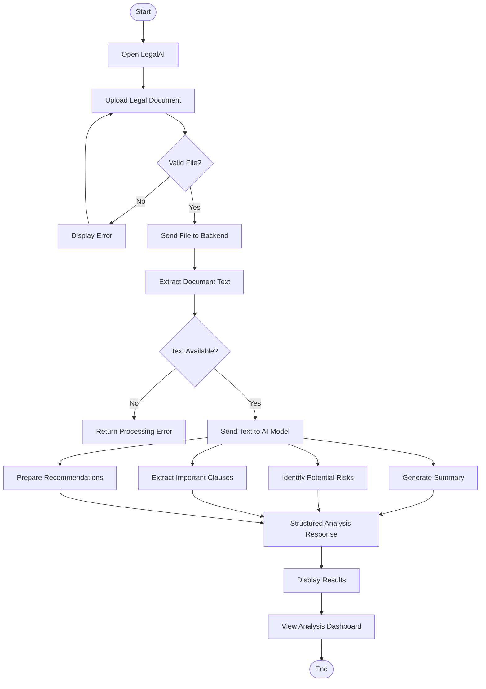

# ⚖️ LegalAI
### AI-Powered Legal Document Analysis Platform

<p align="center">
  <b>Making Legal Documents Easier to Understand with Artificial Intelligence</b>
</p>

<p align="center">
  <a href="https://legalai-2-3ktq.onrender.com/">Live Demo</a> •
  <a href="https://github.com/jyotibagdi-07/legalai">GitHub Repository</a>
</p>

---

## 📌 About The Project

**LegalAI** is an AI-powered legal document analysis platform designed to simplify complex legal documents and make legal information more accessible.

Legal agreements and contracts often contain lengthy clauses, complicated terminology, and important conditions that can be difficult to understand. LegalAI uses Artificial Intelligence to help users analyze documents, generate summaries, identify potential risks, extract important clauses, compare documents, and interact with an AI-powered legal assistant.

The platform combines a web-based frontend, Python FastAPI backend, Node.js/Express chatbot service, and OpenAI API integration.

### 🎯 Problem Statement

Understanding legal documents can be challenging and time-consuming, especially for people without a legal background.

Users often face difficulties in:

- Understanding complex legal terminology.
- Identifying potentially risky clauses.
- Finding important information in lengthy contracts.
- Comparing different versions of legal agreements.
- Getting quick answers about document content.

### 💡 Our Solution

LegalAI provides an integrated platform that transforms lengthy legal documents into structured and understandable insights using AI-powered document processing and analysis.

---

## ✨ Features

| Feature | Description |
|---|---|
| 📄 AI Document Summarization | Generates concise and readable summaries of legal documents. |
| ⚠️ Risk Analysis | Identifies potentially risky clauses and categorizes risks by severity. |
| 🔍 Clause Extraction | Extracts important clauses and provides short explanations. |
| 🤖 AI Legal Chatbot | Allows users to ask questions about uploaded documents. |
| 📑 Document Comparison | Helps compare two legal documents and identify differences. |
| 📊 Analysis Dashboard | Displays structured summaries, risks, and analysis results. |
| 📝 Legal Templates | Provides a template-based legal document editing interface. |
| 📥 Report Generation | Allows users to print or save analysis reports as PDF through the browser. |

---

## 🏗️ System Architecture

LegalAI uses a multi-component architecture with separate services for document analysis and AI-powered chat.



### Architecture Components

**1. Frontend**
- Built using HTML, CSS, and JavaScript.
- Provides document upload and user interaction.
- Displays summaries, risks, clauses, and reports.

**2. Python FastAPI Backend**
- Handles document analysis requests.
- Processes uploaded documents.
- Extracts document text.
- Integrates with the OpenAI API.
- Returns structured analysis responses.

**3. Node.js / Express Backend**
- Handles chatbot-related requests.
- Manages uploaded document context for conversations.
- Connects the chatbot workflow with the AI service.

**4. AI Processing Layer**
- Generates document summaries.
- Identifies potential risks.
- Extracts important clauses.
- Generates document-related responses.

---

## 🔄 End-to-End Workflow



### Workflow Explanation

1. **Document Upload:** User uploads a legal document through the frontend.
2. **Backend Communication:** The frontend sends the document to the appropriate backend API.
3. **Text Extraction:** The backend extracts readable text from the uploaded document.
4. **AI Processing:** Extracted text is passed to the AI model with structured instructions.
5. **Document Analysis:** The system generates summaries, identifies potential risks, and extracts clauses.
6. **Response Generation:** Analysis results are organized into a structured response.
7. **Result Visualization:** The frontend displays the generated insights and reports.

---

## 🛠️ Technology Stack

### Frontend
- HTML5
- CSS3
- JavaScript
- Chart.js
- PDF.js
- Lucide Icons

### Backend
- Python
- FastAPI
- Node.js
- Express.js
- Uvicorn

### Artificial Intelligence
- OpenAI API
- GPT-4o-mini
- Structured Prompt Engineering

### Document Processing
- PyPDF2
- pdf-parse
- Document text extraction utilities

### Development & Deployment
- Git
- GitHub
- Render
- VS Code
- npm
- pip

---

## 📁 Project Structure

```text
legalai/
│
├── assets/
│
├── backend/
│   └── ai/
│       ├── main.py
│       └── utils/
│           ├── ai_summarizer.py
│           └── pdf_reader.py
│
├── frontend/
│   ├── index.html
│   ├── analysis.html
│   ├── fullsum.html
│   ├── risk.html
│   ├── chatbot.html
│   ├── comparison.html
│   ├── template.html
│   ├── pricing.html
│   ├── signin.html
│   │
│   ├── css/
│   ├── js/
│   │   ├── script.js
│   │   ├── chatbot.js
│   │   └── server.js
│   │
│   └── assets/
│
├── scripts/
│   └── train_model.py
│
├── uploads/
│
├── package.json
├── requirements.txt
└── README.md
```

---

## 🔌 API Endpoints

### FastAPI Backend

| HTTP Method | Endpoint | Description |
|---|---|---|
| GET | `/` | Backend health check |
| POST | `/upload` | Upload document and generate summary |
| POST | `/analyze` | Analyze document and identify potential risks |
| POST | `/extract-clauses` | Extract important clauses |
| POST | `/compare` | Compare two legal documents |

### Node.js / Express Backend

| HTTP Method | Endpoint | Description |
|---|---|---|
| GET | `/` | Chat service status |
| POST | `/upload` | Upload document for chatbot context |
| POST | `/chat` | Send a question and receive an AI response |

---

## ⚙️ Installation & Setup

### Prerequisites

Make sure you have installed:

- Python 3.10+
- Node.js 18+
- npm
- Git

### Step 1: Clone the Repository

```bash
git clone https://github.com/jyotibagdi-07/legalai.git

cd legalai
```

### Step 2: Create Python Virtual Environment

```bash
python -m venv .venv
```

Activate the environment.

**Windows:**

```bash
.venv\Scripts\activate
```

**macOS / Linux:**

```bash
source .venv/bin/activate
```

### Step 3: Install Python Dependencies

```bash
pip install -r requirements.txt
```

### Step 4: Install Node.js Dependencies

```bash
npm install
```

### Step 5: Configure Environment Variables

Create a `.env` file in the project root:

```env
OPENAI_API_KEY=your_openai_api_key
```

**Important:** Never expose your API key or commit your `.env` file to GitHub.

### Step 6: Start FastAPI Backend

```bash
python -m uvicorn backend.ai.main:app --host 0.0.0.0 --port 8016 --reload
```

### Step 7: Start Express Chat Service

```bash
node frontend/js/server.js
```

### Step 8: Run Frontend

```bash
python -m http.server 5503 --directory frontend
```

Open your browser:

```text
http://127.0.0.1:5503
```

---

## 🌐 Live Application

**Live Demo:** https://legalai-2-3ktq.onrender.com/

**GitHub Repository:** https://github.com/jyotibagdi-07/legalai

LegalAI is deployed on Render.

---

## 🔐 Security & Responsible AI

- API keys should be stored using environment variables.
- Uploaded documents may contain sensitive information and should be handled carefully.
- File types and uploads should be validated.
- Private document content should not be exposed in public logs or repositories.
- AI-generated results should be reviewed before making important decisions.

---

## 🚧 Current Limitations

- AI-generated analysis may not always be accurate or complete.
- The application depends on external AI API availability.
- Some file formats may have text extraction limitations.
- Uploaded documents currently use local file handling.
- Authentication and persistent document history require further development.

---

## 🚀 Future Enhancements

Some planned improvements include:

- OCR support for scanned PDF documents.
- Semantic comparison of legal documents.
- Secure user authentication and authorization.
- Database integration for document history.
- Cloud-based document storage.
- Multilingual legal document summarization.
- Improved explainability for AI-generated risk analysis.
- Automated testing and CI/CD integration.
- Enhanced document security and validation.

---

## 🧠 Key Learnings

Developing LegalAI provided practical experience in:

- Building and integrating REST APIs.
- Connecting frontend applications with backend services.
- Working with FastAPI and Express.js.
- Integrating external AI APIs.
- Designing document-processing workflows.
- Handling file uploads and text extraction.
- Generating structured AI responses.
- Managing multi-service application architecture.
- Deploying applications using Render.
- Using Git and GitHub for version control.

---

## ⚖️ Disclaimer

LegalAI is an educational and informational project. It provides AI-generated insights to help users understand legal documents. It is not a substitute for professional legal advice or consultation with a qualified legal professional.

---

## 👩‍💻 Author

**Jyoti Bagdi**

B.Tech in Information Technology  
Indira Gandhi Delhi Technical University for Women (IGDTUW)

- GitHub: [@jyotibagdi-07](https://github.com/jyotibagdi-07)
- Project: [LegalAI Repository](https://github.com/jyotibagdi-07/legalai)
- Live Demo: [LegalAI](https://legalai-2-3ktq.onrender.com/)

---

<p align="center">
  <b>Built with ❤️ and Artificial Intelligence</b>
</p>
